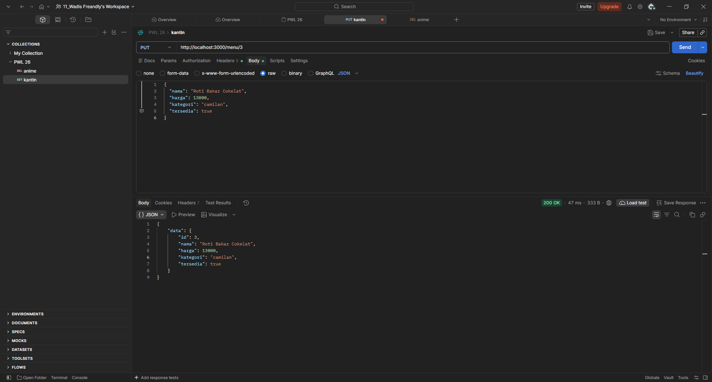
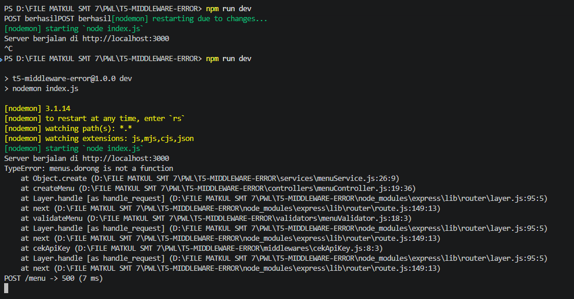
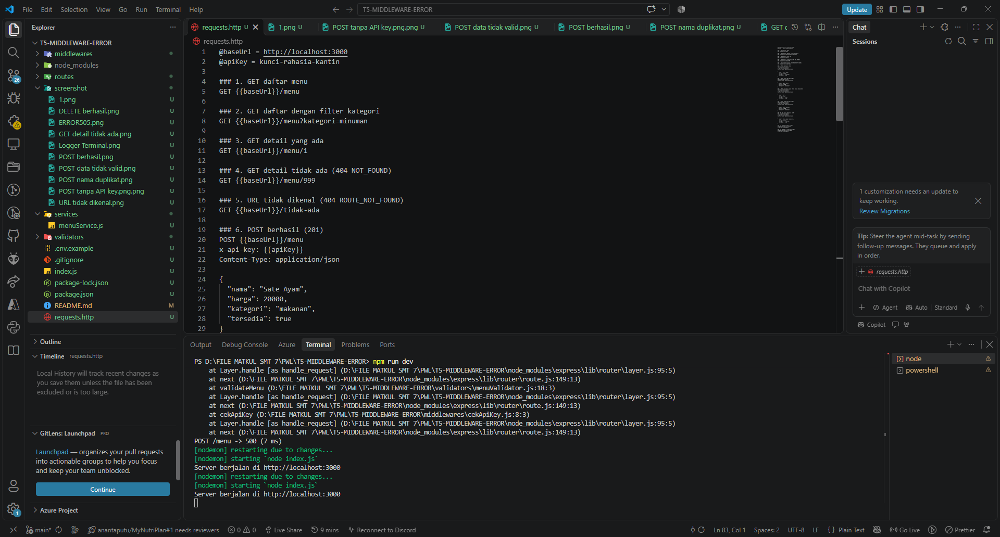

# Tugas 5 - Middleware & Error Terpusat

## Identitas

- Nama : Wadis Freandly
- NIM : F1D02310094 (Varian: B — Kantin)

## Cara Menjalankan

```bash
npm install
npm run dev
```

Server tersedia di `http://localhost:3000`. API key bawaan lokal adalah
`kunci-rahasia-kantin`. Bonus environment aktif: atur `API_KEY` sebelum menjalankan
server untuk mengganti key, misalnya PowerShell: `$env:API_KEY='key-saya'; npm run dev`.
Apabila `API_KEY` tidak diatur, aplikasi sengaja memakai key bawaan agar proyek mudah
didemo. Pada aplikasi produksi, key bawaan seharusnya dihapus dan aplikasi dibuat gagal
berjalan bila variabel belum diatur.

## Struktur Proyek

```text
├── routes/          # Pemetaan URL dan urutan middleware
├── controllers/     # Mengubah request menjadi pemanggilan service dan respons sukses
├── services/        # Aturan bisnis serta operasi async tanpa req/res
├── data/            # Data awal menu dalam memori
├── validators/      # Skema Joi dan middleware validasi
├── middlewares/     # Logger, autentikasi API key, dan error terpusat
├── errors/          # Kelas AppError
├── requests.http    # Skenario uji REST Client
└── screenshot/      # Bukti pengujian (tambahkan screenshot di sini)
```

## Endpoint

| Method      | URL                               | Middleware                  | Status                  |
| ----------- | --------------------------------- | --------------------------- | ----------------------- |
| GET         | `/menu`, `/menu?kategori=minuman` | logger                      | 200                     |
| GET         | `/menu/:id`                       | logger                      | 200, 404                |
| POST        | `/menu`                           | logger, cekApiKey, validasi | 201, 401, 422, 409      |
| PUT (bonus) | `/menu/:id`                       | logger, cekApiKey, validasi | 200, 401, 422, 404, 409 |
| DELETE      | `/menu/:id`                       | logger, cekApiKey           | 204, 401, 404           |

## Aturan Validasi, Aturan Bisnis, dan Kode Error

Joi memvalidasi `nama` (string 3–50, wajib), `harga` ( integer 1.000–100.000,
wajib), `kategori` (`makanan`, `minuman`, atau `camilan`, wajib), serta `tersedia`
(boolean, default `true`). Opsi `abortEarly: false` memastikan semua kesalahan dikirim
bersamaan sebagai `422 VALIDATION_ERROR`.

Nama menu tidak boleh kembar tanpa membedakan kapitalisasi. Aturan ini berada di
service karena perlu membandingkan input dengan data yang sudah tersimpan; Joi hanya
memvalidasi bentuk sebuah input. Pelanggaran menghasilkan `409 NAMA_DUPLIKAT`.

Kode error: `UNAUTHORIZED` (401), `NOT_FOUND` (404), `ROUTE_NOT_FOUND` (404),
`VALIDATION_ERROR` (422), `NAMA_DUPLIKAT` (409), dan `INTERNAL_SERVER_ERROR` (500).
Format semua error adalah `{ "error": { "pesan", "kode" } }`.

## Pengujian

Jalankan server lalu eksekusi seluruh request dalam `requests.http`. File tersebut
mencakup GET daftar/filter/detail/404, rute tidak dikenal, POST 201/401/422/409,
PUT bonus, serta DELETE 204/404. Logger di terminal akan mencetak satu baris per
request, misalnya `POST /menu -> 201 (3 ms)`.

## Screenshot Pengujian

Berikut bukti pengujian endpoint dan middleware yang telah dijalankan.

| Pengujian                             | Screenshot                                                           |
| ------------------------------------- | -------------------------------------------------------------------- |
| GET detail menu tidak ditemukan (404) |    |
| Rute tidak dikenal (404)              |            |
| POST tanpa API key (401)              |    |
| POST data tidak valid (422)           |  |
| POST nama duplikat (409)              |          |
| POST berhasil (201)                   |                      |
| DELETE berhasil (204)                 |                  |
| PUT bonus berhasil (200)              |                                 |
| Error internal (500)                  |                            |
| Logger terminal                       |                  |
| Skenario pada `requests.http`         |                        |

## Deklarasi Penggunaan AI

| Bagian             | Alat AI | Dipakai untuk apa                                           | Cara saya memeriksa hasilnya                                                    |
| ------------------ | ------- | ----------------------------------------------------------- | ------------------------------------------------------------------------------- |
| Diskusi dan review | ChatGPT | Membantu menjelaskan konsep middleware dan penanganan error | Implementasi serta pengujian endpoint dilakukan sendiri melalui `requests.http` |

Contoh Prompt: "Tolong jelaskan saya apa itu Middleware dan Penangan ERROR"

## Kesimpulan & Kendala

Sebelum error terpusat, setiap controller harus menulis respons error sendiri sehingga
formatnya mudah tidak konsisten. Dengan `AppError`, `notFound`, dan `errorHandler`,
controller fokus pada respons sukses dan semua error memiliki format seragam. Kendala
yang perlu diperhatikan adalah urutan middleware: `notFound` dan `errorHandler` harus
setelah semua rute, sedangkan POST harus menjalankan API key sebelum validasi.
